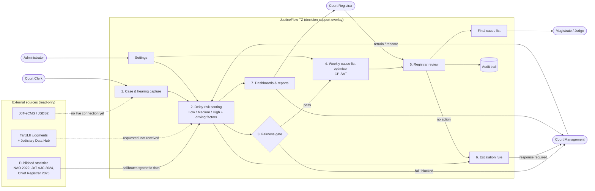
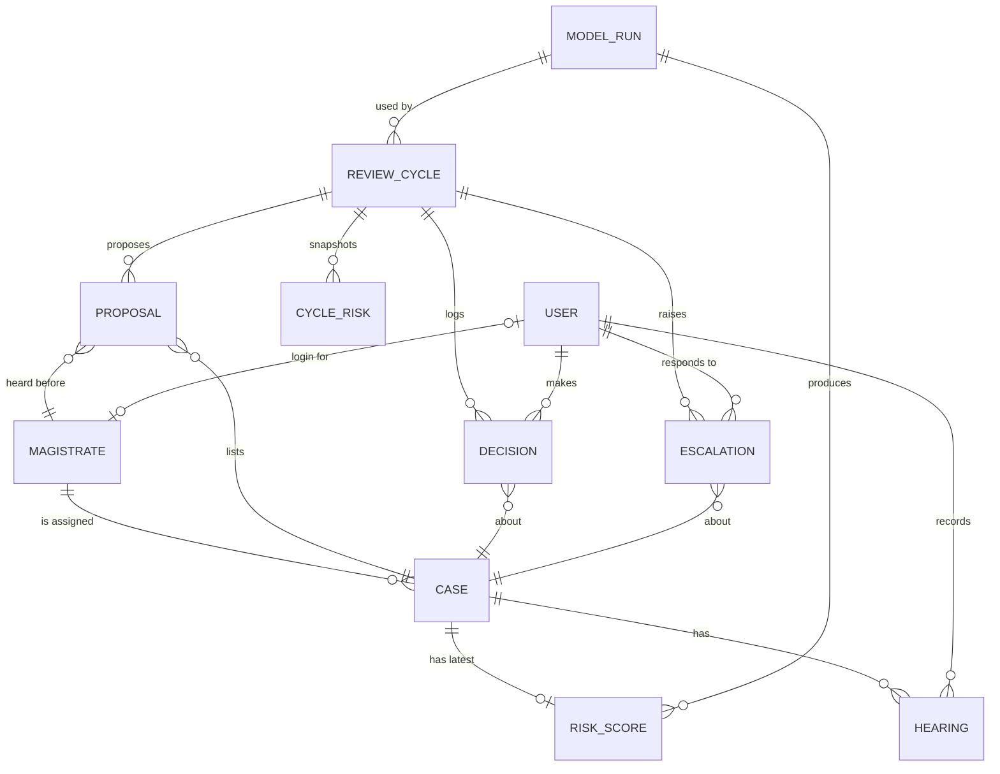

# JusticeFlow TZ: Conceptual Diagram Specification

Use this file as a brief for drawing the conceptual diagram of **JusticeFlow TZ** in any design or AI tool (Figma, Canva, draw.io, Miro, Napkin, Whimsical, Lucid, and so on). It lists every element, group and connection, along with the exact labels and layout guidance. Mermaid versions are at the end for reference.

---

## 1. What the system is (one-line context for the designer)

JusticeFlow TZ is a **read-only decision-support overlay** for Tanzanian courts. It predicts which cases are at risk of exceeding their disposition target and proposes an optimised weekly cause list, which a court registrar must approve. It **never writes back** to the Judiciary's systems (JoT-eCMS / JSDS2), and **no schedule is final until a registrar approves it**.

Place this principle on the diagram as a banner or caption:

> "Read-only overlay: nothing is written back to JoT-eCMS / JSDS2. No schedule is final until a registrar approves it."

---

## 2. Diagram A: Conceptual system diagram

### 2.1 Layout

- **Direction:** left to right.
- **Left column:** external data sources, in a grey box titled "External sources (read-only)".
- **Centre:** one large rounded container titled **"JusticeFlow TZ"**, holding the seven processing steps stacked top to bottom (numbered 1–7), plus Settings and the Audit trail.
- **Around the container:** five human actors (user roles), each placed next to the step they interact with.
  - Court Clerk: left, near step 1.
  - Administrator: bottom-left, near Settings.
  - Court Registrar: right, near step 5.
  - Magistrate / Judge: right, near "Final cause list".
  - Court Management: bottom-right, near steps 6 and 7.

### 2.2 Legend

| Style | Meaning |
|---|---|
| Solid arrow | Built and working |
| Dashed arrow | Planned / not yet connected |
| Rounded rectangle | Process / system function |
| Diamond | Decision / gate |
| Person icon or pill | Human actor (user role) |
| Cylinder | Data store |
| Grey box | External system (outside JusticeFlow) |

### 2.3 Elements

**External sources** (grey group, left)

| ID | Label | Note |
|---|---|---|
| E1 | JoT-eCMS / JSDS2 | Judiciary case management systems |
| E2 | Published statistics (NAO 2022, JoT AJC 2024, Chief Registrar 2025) | Used to calibrate the synthetic demo data |
| E3 | TanzLII judgments + Judiciary Data Hub | Real data for validation, requested but not yet received |

**Actors** (person icons)

| ID | Label | What they do |
|---|---|---|
| A1 | Court Clerk | Registers cases, records hearings and delay flags |
| A2 | Court Registrar | Reviews risk scores and the proposed cause list; approves, edits or removes |
| A3 | Magistrate / Judge | Views their final schedule (read-only) |
| A4 | Court Management | Responds to escalations, views reports and the fairness audit, retrains the model |
| A5 | Administrator | Manages targets, thresholds, magistrate roster and user accounts |

**JusticeFlow TZ processes** (inside the main container)

| ID | Shape | Label | Sub-text |
|---|---|---|---|
| P1 | Rounded rect | 1. Case & hearing capture | Register case, record hearing; delay flags: advocate / prosecution / forensic |
| P2 | Rounded rect | 2. Delay-risk scoring | Gradient-boosted model. Scored at filing, re-scored after every hearing. Output: Low / Medium / High, driving factors, and "court-controllable" vs "externally blocked" |
| P3 | Diamond | 3. Fairness gate | Compares false-positive "High" rates across regions. Region and court station are never model inputs |
| P4 | Rounded rect | 4. Weekly cause-list optimiser | OR-Tools CP-SAT; respects magistrate daily capacity and unavailable days |
| P5 | Rounded rect | 5. Registrar review | Approve / edit / remove listings; approve / override risk; a reason is required and logged |
| P6 | Rounded rect (highlight) | Final cause list | The approved weekly schedule |
| P7 | Rounded rect | 6. Escalation rule | Case rated High for N consecutive weekly cycles with no registrar action |
| P8 | Rounded rect | 7. Dashboards & reports | Backlog trend vs the NAO 12-month benchmark, by court level and station |
| P9 | Rounded rect (small) | Settings | Disposition targets, risk thresholds, roster, users |
| D1 | Cylinder | Audit trail | Registrar decisions, model runs, weekly risk snapshots (append-only) |

### 2.4 Connections

| From | To | Label | Style |
|---|---|---|---|
| E2 | P2 | calibrates synthetic data | solid |
| E1 | P1 | read-only loaders built; no live connection yet | **dashed** |
| E3 | P2 | validation data requested, not received | **dashed** |
| A1 | P1 | enters cases & hearings | solid |
| P1 | P2 | triggers (re)scoring | solid |
| P2 | P3 | scores | solid |
| P3 | P4 | pass | solid (green) |
| P3 | A4 | fail: scheduling blocked | solid (red) |
| P4 | P5 | proposed cause list | solid |
| A2 | P5 | reviews & decides | solid |
| P5 | P6 | approved listings only | solid |
| P5 | D1 | every decision logged | solid |
| P6 | A3 | weekly schedule | solid |
| P2 | P7 | High-risk history | solid |
| P5 | P7 | no action taken | solid |
| P7 | A4 | escalation note; response required | solid |
| P2 | P8 | risk & backlog data | solid |
| P8 | A4 | reports, fairness audit | solid |
| P8 | A2 | dashboard | solid |
| A5 | P9 | configures | solid |
| P9 | P2 | targets & thresholds | solid |
| P9 | P4 | roster & capacity | solid |
| A4 | P2 | retrain / rescore model | solid |

### 2.5 Suggested colours

- External sources: light grey (#E5E7EB), dark grey text.
- JusticeFlow container: very light blue (#EFF6FF) with a navy border (#1E3A8A).
- Process boxes: white with a navy border.
- Fairness gate: amber (#F59E0B).
- Final cause list: green (#16A34A) fill with white text.
- Escalation rule: soft red (#FEE2E2) with a red border (#DC2626).
- Actors: navy person icons.
- Risk categories, if shown: Low = green, Medium = amber, High = red.

---

## 3. Diagram B: Conceptual data model (optional second diagram)

These are entities and relationships only, drawn in crow's-foot notation. Attributes can be left off, because this is a conceptual model.

### 3.1 Entities

| Entity | Meaning |
|---|---|
| USER | A login account with one role: clerk, registrar, magistrate, management or admin |
| MAGISTRATE | A judicial officer with a court level, station, daily capacity and unavailable days |
| CASE | A court case (type, court level, parties, representation, filing date, status) |
| HEARING | One hearing of a case: outcome, adjournment reason, delay flags |
| RISK_SCORE | The latest delay-risk score for a case, plus the registrar's review of it |
| MODEL_RUN | One trained model version with its metrics and fairness-audit result |
| REVIEW_CYCLE | One weekly scheduling cycle (Proposed → Approved) |
| PROPOSAL | One proposed cause-list slot: case, magistrate, day, position |
| CYCLE_RISK | A snapshot of each pending case's risk at cycle creation, used for escalations |
| DECISION | An append-only log entry of a registrar action, with a reason |
| ESCALATION | A note to management about a persistently high-risk case, plus their response |
| SETTING | A configurable value (targets, thresholds) |

### 3.2 Relationships

| Entity A | Cardinality | Entity B | Label |
|---|---|---|---|
| MAGISTRATE | 1 — 0..many | CASE | is assigned |
| CASE | 1 — 0..many | HEARING | has |
| CASE | 1 — 0..1 | RISK_SCORE | has latest |
| MODEL_RUN | 1 — 0..many | RISK_SCORE | produces |
| MODEL_RUN | 1 — 0..many | REVIEW_CYCLE | used by |
| REVIEW_CYCLE | 1 — 0..many | PROPOSAL | proposes |
| PROPOSAL | many — 1 | CASE | lists |
| PROPOSAL | many — 1 | MAGISTRATE | heard before |
| REVIEW_CYCLE | 1 — 0..many | CYCLE_RISK | snapshots |
| REVIEW_CYCLE | 1 — 0..many | DECISION | logs |
| DECISION | many — 1 | CASE | about |
| REVIEW_CYCLE | 1 — 0..many | ESCALATION | raises |
| ESCALATION | many — 1 | CASE | about |
| USER (clerk) | 1 — 0..many | HEARING | records |
| USER (registrar) | 1 — 0..many | DECISION | makes |
| USER (management) | 1 — 0..many | ESCALATION | responds to |
| USER | 0..1 — 0..1 | MAGISTRATE | login for |

---

## 4. Current status (show as a small table or a set of badges)

| Area | Status |
|---|---|
| Case & hearing capture, risk scoring, driving factors, delay status | Built |
| Fairness gate | Built |
| CP-SAT weekly scheduler + registrar review | Built |
| Escalations, dashboards, reports, settings | Built |
| Read-only ingest from JoT-eCMS / JSDS2 | Loaders built; no live connection |
| Real case data | Not yet: the demo uses synthetic cases fitted to published figures |
| External authentication (Supabase / Firebase) | Not yet: uses local login for now |

---

## 5. Prompt you can paste into a design AI

> Create a clean, professional **conceptual system diagram** for "JusticeFlow TZ", a read-only AI decision-support tool for Tanzanian courts. Layout: left to right. On the left, a grey group "External sources (read-only)" holds three items: JoT-eCMS / JSDS2, Published statistics (NAO, JoT), and TanzLII + Judiciary Data Hub. In the centre, a large rounded container "JusticeFlow TZ" holds these numbered steps from top to bottom: 1. Case & hearing capture, 2. Delay-risk scoring (Low/Medium/High + driving factors), 3. Fairness gate (diamond), 4. Weekly cause-list optimiser (CP-SAT), 5. Registrar review, then Final cause list (green), 6. Escalation rule (red), 7. Dashboards & reports, plus a small Settings box and an Audit trail cylinder. Around the container are five person icons: Court Clerk → step 1; Court Registrar → step 5; Final cause list → Magistrate/Judge; Escalation rule and Reports → Court Management; Administrator → Settings. Use solid arrows for working connections and dashed arrows for planned ones (JoT-eCMS → step 1, TanzLII → step 2). The Fairness gate has a green "pass" arrow to step 4 and a red "fail: scheduling blocked" arrow to Court Management. Add a caption: "Read-only overlay: nothing is written back to court systems. No schedule is final until a registrar approves it." Use a navy, white and grey palette, with amber for the gate, green for the final list and red for escalation. Follow the full element and connection tables in this file.

---

## 6. Mermaid reference (renders in VS Code preview or mermaid.live)

### Diagram A

### Diagram B

