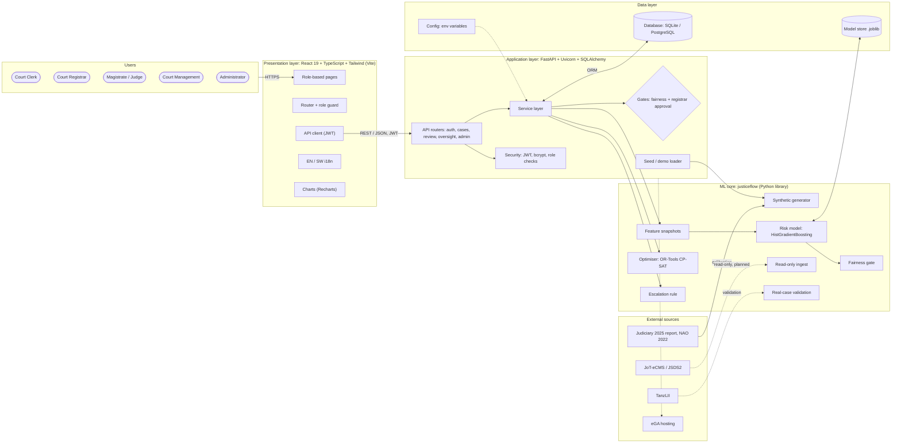

# JusticeFlow TZ: Technical Architecture Diagram Specification

Use this file as a brief for drawing the **technical architecture diagram** of JusticeFlow TZ in any design or AI tool (ChatGPT, draw.io, Figma, Lucid, Miro). It lists every component, layer, data store and connection with exact labels. A ready-to-paste prompt and a Mermaid version are at the end.

---

## 1. One-line context

JusticeFlow TZ is a **three-tier web application** (React frontend → FastAPI backend → database) with a separate **Python ML core** for risk prediction, fairness checking and cause-list optimisation. It is a **read-only overlay** for the Judiciary of Tanzania (Tanzania Mainland): it never writes to the Judiciary's systems (JoT-eCMS / JSDS2).

Caption to place on the diagram:

> "Read-only overlay: nothing is written back to JoT-eCMS / JSDS2. No schedule is final until a registrar approves it."

---

## 2. Layout (left to right, five vertical lanes)

| Lane | Title | What goes in it |
|---|---|---|
| 1 | **Users** | Five role icons |
| 2 | **Presentation layer** (browser) | React web app |
| 3 | **Application layer** (server) | FastAPI backend: API routers, security, service layer |
| 4 | **ML core** (Python package `justiceflow`) | Seven ML/optimisation modules |
| 5 | **Data layer** + **External sources** | Database, model files; external systems at the far right in a grey box |

Draw the **ML core** as a box that the backend calls *into* (it is a library, not a separate server).

---

## 3. Components

### Lane 1: Users (person icons)

| ID | Label |
|---|---|
| U1 | Court Clerk |
| U2 | Court Registrar |
| U3 | Magistrate / Judge |
| U4 | Court Management |
| U5 | Administrator |

All five connect to the web app over **HTTPS (browser)**.

### Lane 2: Presentation layer: "Web app (React SPA)"

One large box with this stack label: **React 19 + TypeScript + Tailwind CSS v4, built with Vite**.

Inside it, small boxes:

| ID | Label | Note |
|---|---|---|
| F1 | Role-based pages | Case data entry, Review queue, Cause list, Criminal sessions, My schedule, Escalations, Committee agenda, Reports, Fairness audit, Settings |
| F2 | Router + role guard | React Router 7; each role sees only its pages |
| F3 | API client | Fetch with JWT bearer token; calls `/api/...` |
| F4 | i18n | English / Kiswahili switch |
| F5 | Charts | Recharts (reports) |

### Lane 3: Application layer: "Backend API (FastAPI, Python)"

Stack label: **FastAPI + Uvicorn, SQLAlchemy ORM, Pydantic**. Port 8000; OpenAPI docs at `/docs`.

| ID | Label | Contents |
|---|---|---|
| B1 | Security | JWT login, bcrypt passwords, role checks (`require(role)`) |
| B2 | API routers | `auth` (login, users) · `cases` (case list, detail, hearings, registration, next-date suggestion) · `review` (cause lists, decisions, risk review, needs-attention, criminal sessions, my schedule) · `oversight` (dashboard, escalations, committee agenda, reports, fairness, retrain) · `admin` (settings, magistrate roster) |
| B3 | Service layer (`services.py`) | Scoring, weekly cause-list building, next-date suggestion, needs-attention list, session planning, escalation routing, backlog reports |
| B4 | Gates | **Fairness gate** (blocks scheduling and real-data scoring with HTTP 409 if failed) · **Human-in-the-loop** (nothing scheduled without registrar approval) |
| B5 | Seed / demo loader | `app.seed`: synthetic data, trains model, replays 3 past weeks |

### Lane 4: ML core: "justiceflow (Python library)"

| ID | Module | Label / what it does | Technology |
|---|---|---|---|
| M1 | `synthetic.py` | Synthetic data generator, calibrated to Judiciary 2025 figures | NumPy, pandas |
| M2 | `features.py` | Case snapshots: at filing and after each hearing; protected fields (region, station) excluded | pandas |
| M3 | `model.py` | **Risk model**: probability a case overruns its disposition target → Low / Medium / High, plus driving factors | scikit-learn **HistGradientBoostingClassifier** |
| M4 | `fairness.py` | **Fairness gate**: false-positive "High" rate by region; reweights and retrains until gap ≤ 10% | scikit-learn (fairlearn optional) |
| M5 | `scheduler.py` | **Cause-list optimiser**: keeps dates fixed in court, fills free capacity; cases stay with their officer; remand priority | Google **OR-Tools CP-SAT** |
| M6 | `review.py` | Escalation rule: High for 3 consecutive weeks with no action | pandas |
| M7 | `ingest.py` | **Read-only** loaders: CSV, Google Sheets CSV, TanzLII sample; future e-CMS export | pandas |
| M8 | `check_tanzlii.py` | Real-case validation report | scikit-learn metrics |

### Lane 5a: Data layer

| ID | Shape | Label | Note |
|---|---|---|---|
| D1 | Cylinder | **Relational database** | SQLite by default; PostgreSQL (Supabase / Neon) via `DATABASE_URL` |
| D2 | Folder icon | **Model store** | Trained model files (`.joblib`) |
| D3 | Gear icon | **Configuration** | Environment variables: `DATABASE_URL`, `JF_SECRET_KEY`, `JF_AS_OF`, `JF_CALIBRATION`, `JF_MODEL_DIR` |

Tables to list inside D1 (small text, grouped):
- **People and courts:** users, magistrates
- **Cases:** cases, hearings
- **Model:** model_runs, risk_scores
- **Weekly cycle:** review_cycles, proposals, cycle_risk, decisions (append-only audit log)
- **Oversight:** escalations, session_plans, session_cases, settings

### Lane 5b: External sources (grey box, far right)

| ID | Label | Status | Line style |
|---|---|---|---|
| X1 | JoT-eCMS / JSDS2 (Judiciary systems) | Read-only export planned, not connected | **dashed** |
| X2 | TanzLII (published judgments) | Used for the real-case test; bulk access requested | **dashed** |
| X3 | Published reports (Judiciary 2025 report, NAO 2022) | Used to calibrate synthetic data | solid |
| X4 | Government hosting (eGA) | Planned deployment target | **dashed** |

---

## 4. Connections

| # | From | To | Label | Style |
|---|---|---|---|---|
| 1 | U1–U5 | F1 Web app | HTTPS (browser) | solid |
| 2 | F3 API client | B2 API routers | REST / JSON over HTTPS, JWT bearer token (`/api/*`) | solid, thick |
| 3 | B2 | B1 Security | authenticate + check role | solid |
| 4 | B2 | B3 Service layer | calls | solid |
| 5 | B3 | D1 Database | read / write (SQLAlchemy ORM) | solid, two-way |
| 6 | B3 | M2 → M3 | score cases (at filing, after each hearing) | solid |
| 7 | B3 | M5 Scheduler | build weekly cause list | solid |
| 8 | B3 | M6 Escalation rule | find stuck cases on finalise | solid |
| 9 | M3 | M4 Fairness gate | audit before use | solid |
| 10 | M3 | D2 Model store | save / load trained model | solid, two-way |
| 11 | B5 Seed | M1 Generator | generate demo data | solid |
| 12 | X3 Published reports | M1 Generator | calibration figures | solid |
| 13 | X1 JoT-eCMS / JSDS2 | M7 Ingest | read-only export | **dashed** |
| 14 | X2 TanzLII | M8 Validation | real decided cases | **dashed** |
| 15 | D3 Config | B3 | settings | thin dotted |
| 16 | Backend + DB | X4 eGA hosting | planned deployment | **dashed** |

Add a red **"no write-back"** marker (a crossed arrow) from the backend toward X1.

---

## 5. Two flows to highlight (optional numbered badges)

**Flow A: Clerk records a hearing**
1. Clerk saves a hearing in the web app.
2. `POST /api/cases/{id}/hearings` reaches the backend.
3. Service layer stores it in the database.
4. ML core re-scores the case (features → risk model).
5. The new risk score is saved and shown to the registrar.

**Flow B: Weekly cause list**
1. Registrar clicks "Propose next week's list".
2. The fairness gate is checked (blocked if failed).
3. The service layer collects dates fixed in court plus cases with no date.
4. The CP-SAT scheduler fills free slots.
5. Proposals are saved; the registrar approves, edits or removes each.
6. Finalise saves next dates and runs the escalation rule.

---

## 6. Legend and colours

| Element | Style |
|---|---|
| Users | Navy person icons |
| Presentation layer | Light blue box (#EFF6FF), navy border |
| Application layer | White box, navy border (#1E3A8A) |
| ML core | Light purple box (#F3E8FF), purple border |
| Gates (fairness, human approval) | Amber diamonds or shields (#F59E0B) |
| Data layer | Grey-green cylinders |
| External sources | Grey box (#E5E7EB) |
| Solid arrow | Built and working |
| Dashed arrow | Planned / not yet connected |
| Red crossed arrow | No write-back to Judiciary systems |

---

## 7. Prompt to paste into ChatGPT

> Draw a clean, professional **technical architecture diagram** for "JusticeFlow TZ", a read-only AI decision-support web app for the Judiciary of Tanzania (Tanzania Mainland). Use five lanes from left to right:
> 1. **Users:** Court Clerk, Court Registrar, Magistrate/Judge, Court Management, Administrator (person icons), connected over HTTPS to the web app.
> 2. **Presentation layer:** "Web app – React 19 + TypeScript + Tailwind, Vite" containing: Role-based pages, Router + role guard, API client (JWT), English/Kiswahili i18n, Charts (Recharts).
> 3. **Application layer:** "Backend API – FastAPI + Uvicorn, SQLAlchemy" containing: Security (JWT, bcrypt, role checks); API routers (auth, cases, review, oversight, admin); Service layer (scoring, cause-list building, next-date suggestion, needs-attention, criminal sessions, escalation routing, reports); Gates (Fairness gate, Registrar approval). The web app calls it with REST/JSON over HTTPS on /api.
> 4. **ML core (Python library "justiceflow")** called by the service layer: Synthetic data generator (calibrated to Judiciary 2025 figures); Feature snapshots; Risk model (scikit-learn HistGradientBoosting → Low/Medium/High + driving factors); Fairness gate (regional false-positive check, reweighting); Cause-list optimiser (Google OR-Tools CP-SAT); Escalation rule; Read-only ingest; Real-case validation.
> 5. **Data layer:** Relational database (SQLite / PostgreSQL) with tables users, magistrates, cases, hearings, model_runs, risk_scores, review_cycles, proposals, decisions (audit log), escalations, session_plans, settings; Model store (.joblib files); Configuration (environment variables).
> On the far right, a grey **External sources** box: JoT-eCMS / JSDS2 (dashed arrow to the ingest module, "read-only, planned"), TanzLII (dashed arrow to validation), Published reports – Judiciary 2025 & NAO 2022 (solid arrow to the generator, "calibration"), eGA government hosting (dashed, "planned deployment"). Add a red crossed arrow from the backend to JoT-eCMS labelled "no write-back". Add a caption: "Read-only overlay: nothing is written back to JoT-eCMS / JSDS2. No schedule is final until a registrar approves it." Colours: navy and white for the app layers, light purple for the ML core, amber for gates, grey for external systems. Solid arrows = working, dashed = planned.

---

## 8. Mermaid reference (renders in VS Code preview or mermaid.live)

